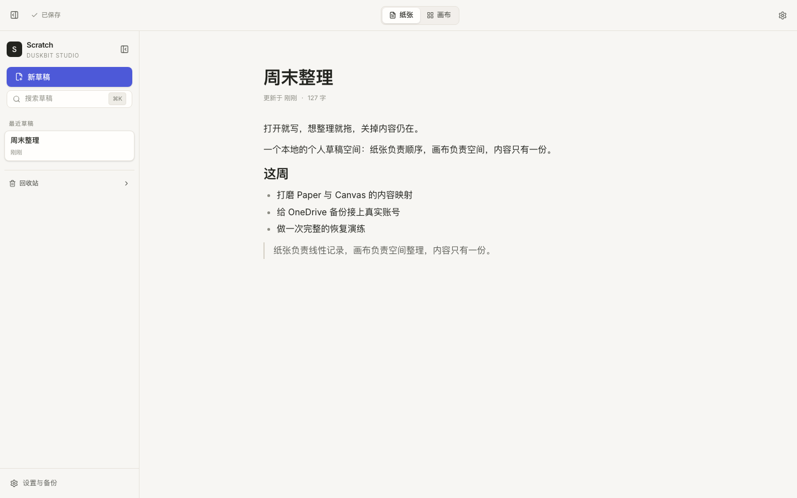
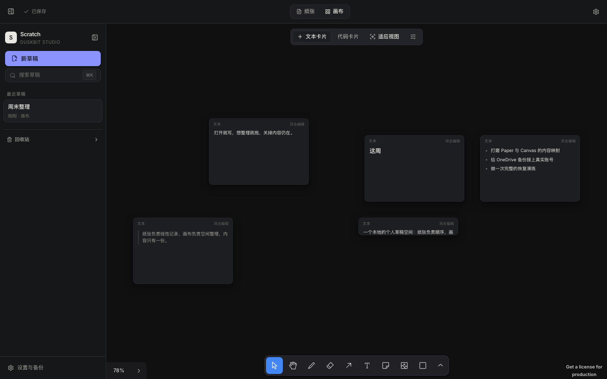
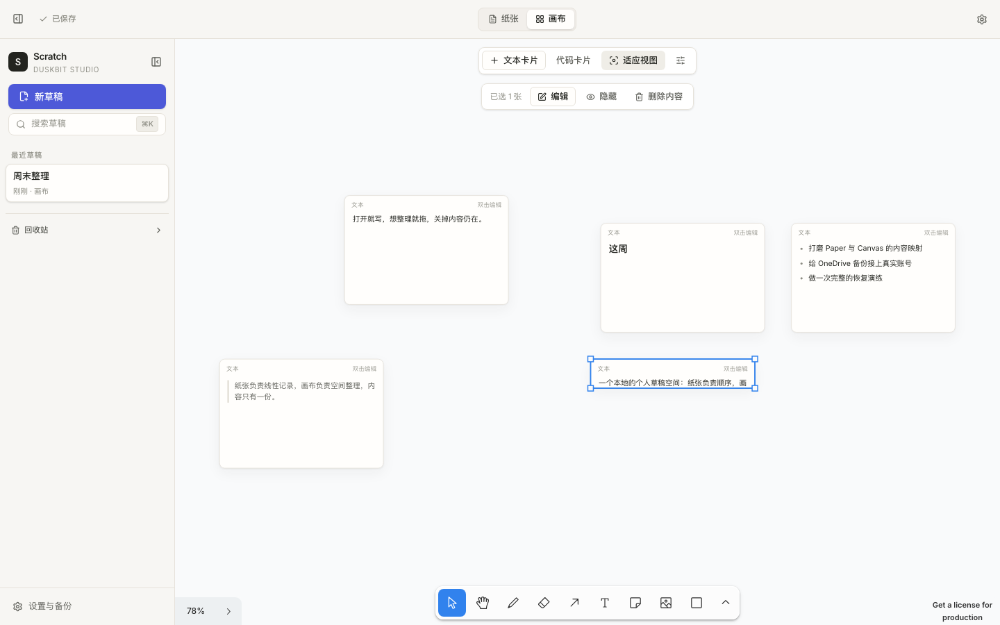
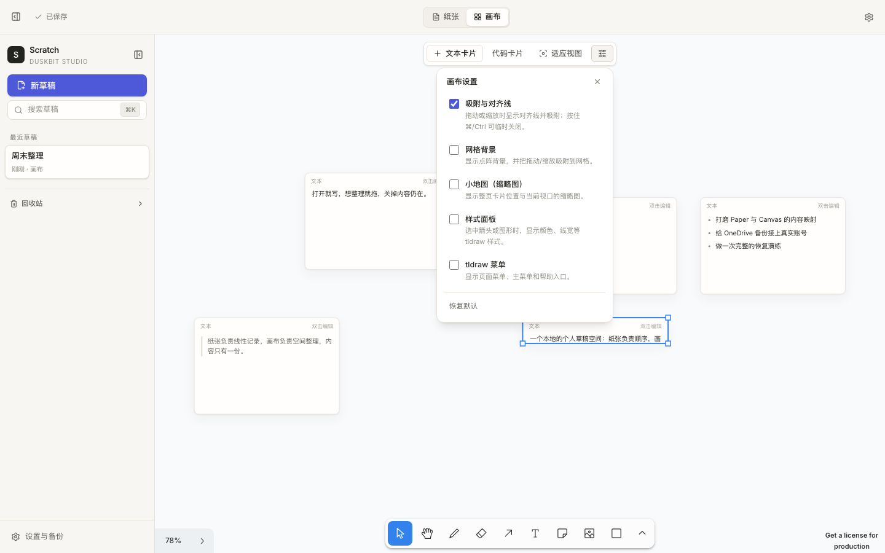
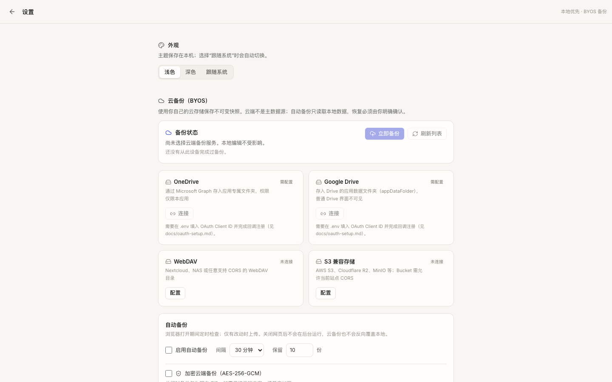
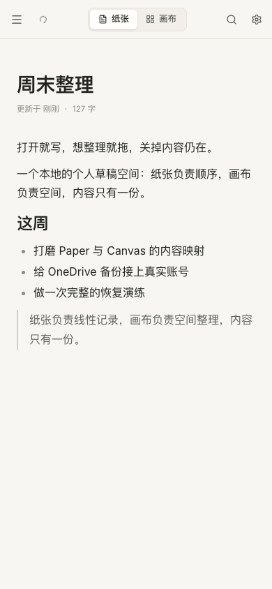

# Scratch

> Duskbit Studio · 个人网页草稿空间
>
> **打开就写，想整理就拖，关掉内容仍在。**

Scratch 是一个 local-first 的个人草稿应用：**纸张（Paper）** 负责线性书写，**画布（Canvas）** 负责空间整理，两者共享同一份内容。数据默认只保存在浏览器的 IndexedDB 中；云备份（BYOS）只是可选的异地快照，不参与实时同步。

---

## 当前状态

按规范 M0–M5 实现，代码、测试与文档均在本仓库内：

| 里程碑 | 状态 | 说明 |
| --- | --- | --- |
| M0 工程基础 | ✅ | Vite + React 18 + TypeScript、Tailwind 4、App Shell、主题、测试与 CI |
| M1 数据核心 | ✅ | Block 模型、Dexie、保存队列、历史快照、导入导出、跨标签冲突检测 |
| M2 Paper | ✅ | Tiptap 富文本、Markdown 快捷输入与粘贴解析、表格、代码高亮、图片、斜杠菜单、拖拽块 |
| M3 Canvas | ✅（受许可阻塞） | tldraw 5 自定义 BlockShape、双击编辑、连线/分组、视图持久化、画布显示设置、双模式闭环 |
| M4 BYOS 备份 | ✅（外部凭证未验证） | `.scratchbackup` 协议、AES-256-GCM 加密、OneDrive / Google Drive / WebDAV / S3 适配、自动备份、恢复与安全备份 |
| M5 发布准备 | ✅ | 响应式、深浅色、无障碍状态、PWA 离线、E2E、文档 |

> **tldraw 许可**：开发与本地测试可免费使用 tldraw SDK。官方提供**免费 100 天 trial**（每个商业主体一次）和需申请、非商用且带水印的 **hobby 许可**；商业生产必须购买有效 license key（`VITE_TLDRAW_LICENSE_KEY`）。未授权构建会显示 “Get a license for production”，不能作为已发布生产方案。详见 [ADR-0002](docs/decisions/0002-tldraw-license.md)。

## 功能

- **Paper**：H1–H3、列表、待办、引用、分隔线、表格、粗体/斜体/删除线/行内代码/链接、代码块（lowlight 高亮 + 语言选择 + 复制）、图片粘贴/拖入（存入 IndexedDB）、`/` 插入菜单、块拖拽排序、Markdown 快捷输入。粘贴 Markdown 时会自动识别带 HTML 包装的剪贴板内容，并转换表格、任务列表与图片外链。
- **Canvas**：无限画布、平移缩放、自定义内容卡片、拖拽/缩放、连线、分组、框选、双击卡片编辑、从画布新建文本/代码卡片、卡片隐藏与恢复。画布右上角的**画布设置**可开关小地图、常开吸附对齐、网格背景、样式面板和 tldraw 菜单；设置保存在本机。
- **同一份内容**：Paper 的每个顶层块与 Canvas 卡片共享稳定 `blockId`。来回切换不复制正文、不重置布局；删除画布卡片默认只隐藏内容，显式“删除内容”才会从纸张中移除。
- **草稿管理**：新建、重命名、回收站、恢复、永久删除、标题自动取首行、`⌘/Ctrl+K` 全文搜索（标题 + 正文）、`⌘/Ctrl+N` 新建。
- **本地优先**：IndexedDB（Dexie）、500ms 防抖 + 2s 最长延迟保存、串行写入、每 5 分钟历史快照、刷新恢复、`BroadcastChannel` 跨标签通知、乐观 revision 冲突检测与显式解决。
- **备份**：完整 `.scratchbackup`（ZIP，含图片与画布）、可选 AES-256-GCM 加密、纯 Markdown 导出、本地安全备份、OneDrive（首发）/ Google Drive / WebDAV / S3 兼容存储、手动与浏览器打开期间自动备份、历史列表与恢复。
- **界面**：浅色 / 深色 / 跟随系统、`prefers-reduced-motion`、键盘焦点态、桌面/平板/手机布局、PWA 离线启动。

## 快速开始

```bash
npm install
cp .env.example .env
npm run dev
```

打开 http://localhost:5173 。首次访问会自动创建空白草稿并聚焦编辑区。

生产构建与本地预览：

```bash
npm run build
npm run preview
```

## 环境变量

| 变量 | 必填 | 说明 |
| --- | --- | --- |
| `VITE_APP_URL` | 部署时建议 | 应用公开地址；OAuth 回调与之保持一致。 |
| `VITE_TLDRAW_LICENSE_KEY` | **生产必填** | tldraw 生产许可。留空仅适合开发。 |
| `VITE_ONEDRIVE_CLIENT_ID` | OneDrive 时 | Entra SPA 应用 Client ID（公共客户端，禁止 Secret）。 |
| `VITE_ONEDRIVE_TENANT` | 否 | 默认 `consumers`。 |
| `VITE_ONEDRIVE_REDIRECT_URI` | 建议 | 默认 `${origin}/`，必须与 Entra 注册一致。 |
| `VITE_GOOGLE_CLIENT_ID` | Google Drive 时 | Google OAuth Web Client ID。 |
| `VITE_GOOGLE_REDIRECT_URI` | 建议 | 默认 `${origin}/`。 |
| `VITE_MAX_BACKUP_BYTES` | 否 | 单个备份包大小上限，默认 256 MB。 |

完整 OAuth 配置步骤见 [docs/oauth-setup.md](docs/oauth-setup.md)。

## 验证

```bash
npm run typecheck   # tsc -b
npm run lint        # ESLint
npm test            # Vitest：44 个单元/集成测试
npm run build       # 生产构建 + PWA Service Worker
npx playwright test # 9 个端到端测试（Chromium）
npm run test:e2e:offline # 生产构建下的离线启动/编辑测试
```

实际结果（2026-11-10，Node 22 / macOS）：

- 单元 + 集成：**44 passed**（内容模型、备份协议/加密/篡改检测、S3 SigV4 AWS 官方向量、四类云 Provider 的 mock API 请求、DocumentService、多标签冲突、备份服务与自动备份门控）。
- E2E：**9 passed**（写作与双模式闭环及刷新恢复、导出并恢复 `.scratchbackup`、搜索/回收站、斜杠菜单/Markdown 快捷输入/块拖拽手柄、6 轮模式切换稳定性、图片插入并同步到画布、粘贴 Markdown 转富文本、画布设置切换与持久化、带 HTML 包装的 Markdown（表格/任务/图片）解析）。
- 离线 E2E：**1 passed**（生产构建 + Service Worker，断网后仍可启动和编辑）。

## 架构摘要

```text
React App Shell
  ├── Paper (Tiptap)  ── paper-adapter（顶层节点 ↔ Block）
  ├── Canvas (tldraw) ── canvas-adapter（BlockShape ↔ Block）
  │                    └── Document Core（Block / order / revision）
  │                          └── Repository + Save Queue（Dexie）
  │                                └── Backup（ZIP / 加密 / Providers）
```

- 正文唯一权威源是 `ContentBlock.content`；Tiptap 与 tldraw 都只是视图。
- 每个顶层 ProseMirror 节点带稳定 `blockId`；空段落不会生成 Block 或卡片，回车拆分产生的重复 ID 由插件自动修正。
- 粘贴看起来像 Markdown 的纯文本会自动转成富文本；代码块带语言选择与复制按钮。
- 画布卡片只保存 `blockId` 与尺寸；删除卡片默认加入隐藏列表，不删除内容。
- 画布显示偏好（吸附/网格/小地图/样式面板/菜单）由右上角画布设置控制，保存在本机。
- 写入按 revision 乐观校验；另一个标签页的更新通过 `BroadcastChannel` 通知，冲突时显式让你选择“放弃本地并加载”或“保留本地并覆盖”。

更多细节：[架构](docs/architecture.md) · [备份格式](docs/backup-format.md) · [部署](docs/deployment.md) · [决策记录](docs/decisions/)。

## 截图

| Paper（浅色） | Canvas（深色） |
| --- | --- |
|  |  |

| Canvas（浅色） | 画布设置 |
| --- | --- |
|  |  |

| 设置与备份 | 手机 Paper |
| --- | --- |
|  |  |

## 已知限制

1. **tldraw 生产许可未取得**：未设置 `VITE_TLDRAW_LICENSE_KEY` 时画布带水印；这不是可发布的生产配置。代码未绕过任何许可/水印校验。
2. **OneDrive / Google Drive 未用真实账号联调**：OAuth App 需要你亲自注册并提供 Client ID。无凭证时 UI 明确显示“需配置/未连接”，不会伪造成连接成功。WebDAV / S3 可在设置页填写自有配置后真实使用，但服务必须允许当前站点的 CORS。
3. **恢复是“整体替换”**：v1 未实现按 ID 合并导入；恢复前会自动生成本地安全备份，并再次确认。
4. **历史快照不提供独立 UI**：每 5 分钟/恢复前快照会写入 IndexedDB（每草稿最多 50 份），v1 的恢复入口是 `.scratchbackup` 与“本地安全备份”；快照表已为后续 UI 预留。
5. **自动备份只在页面打开时运行**，没有任何后台任务；无内容变化不上传；失败不会覆盖 `latest` 元数据或删除最后一个有效快照。
6. **Markdown 导出不含画布布局**，图片会打包进 ZIP；完整迁移请使用 `.scratchbackup`。
7. **跨域名/跨浏览器不自动迁移**：IndexedDB 属于 origin，`editor.nerakolo.cc` 与 `scratch.duskbit.dev` 是两份本地数据，必须通过备份/导入迁移。
8. **大文件/浏览器容量**：单图上限 20 MB、备份包默认 256 MB、解压总量 512 MB；超大 ZIP 会被拒绝而不是尝试硬解。导入解析目前在主线程完成（受上述大小上限约束），超大包会有短暂卡顿。
9. **移动端**提供浏览与基础编辑；复杂画布操作（大量卡片/精确缩放）仍以桌面体验为主。
10. **tldraw 自带图片工具**产生的资源可能内嵌进画布快照并增大备份；Scratch 自身的图片粘贴走 IndexedDB 资源表。
11. **没有字体切换/手写体**：界面与正文使用系统无衬线字体栈（Inter / PingFang / 微软雅黑）。需要手写体时应作为“外观”设置单独设计，并自托管中文字体子集以保持离线能力。

## 必须由你亲自完成的外部事项

- 在 Microsoft Entra 注册 SPA 应用，配置 `Files.ReadWrite.AppFolder` 与回调地址，提供 `VITE_ONEDRIVE_CLIENT_ID`。
- 在 Google Cloud Console 创建 OAuth Web Client，启用 Drive API，配置 `drive.appdata` 与回调地址。
- 取得并配置 tldraw 生产许可：可先申请免费 100 天 trial 或非商用 hobby 许可；商业生产需购买商业许可。
- 决定部署域名（默认计划 `editor.nerakolo.cc`）并执行真实部署。
- 创建 GitHub 远端 `DuskbitStudio/Scratch` 并授权推送；**本仓库当前没有远端、没有推送、没有部署**。
- 旧 Markdown Editor 仓库的归档需你明确授权；本任务未执行任何归档操作。

## 脚本

| 命令 | 作用 |
| --- | --- |
| `npm run dev` | 开发服务器 |
| `npm run build` | 类型检查 + 生产构建 + PWA |
| `npm run preview` | 预览生产构建 |
| `npm run typecheck` / `lint` | 静态检查 |
| `npm test` / `test:watch` | Vitest |
| `npx playwright test` | 端到端 |
| `npm run test:e2e:offline` | 生产构建离线测试 |
| `npm run check` | typecheck + lint + test + build |

## 目录

```text
src/
  app/                App Shell、路由、命令式布局
  core/               模型、schema、纯函数（不依赖 UI/DB）
  storage/            Dexie、Repository、保存队列/冲突、历史
  features/
    paper/            Tiptap、Block ID 插件、图片节点、斜杠菜单
    canvas/           tldraw Shape、卡片预览、双击编辑浮层
    scratches/        侧栏、回收站
    search/           命令面板搜索
    backup/           归档、加密、Provider、自动备份、恢复 UI
  shared/             UI primitives、主题、Toast、格式化
tests/
  unit/ integration/ e2e/ offline/
docs/                 架构、备份格式、OAuth、部署、ADR、截图
```

## 安全与隐私

- 富文本只允许白名单 schema；卡片预览由 React 结构化渲染，不使用 `dangerouslySetInnerHTML`。
- 云服务凭证/OAuth Token 只保存在本机 IndexedDB 或会话存储，**绝不写入备份包/日志**。
- 加密备份使用 Web Crypto：PBKDF2-SHA-256（310,000 次）派生密钥 + AES-256-GCM；密码不落盘，遗忘无法恢复。
- 导入包在解压前检查 ZIP 中央目录、文件数、单文件/总解压体积，失败时不触碰现有数据；恢复前生成安全快照。
- PWA 只缓存应用静态资源，不缓存任何备份 Provider API 响应。
- 浏览器无法完全防御 XSS 读取本地凭证；请保持依赖更新并考虑部署 CSP（见 [部署文档](docs/deployment.md)）。

## License

Licensed under the [Apache License, Version 2.0](LICENSE). See [NOTICE](NOTICE) for attribution.

---

Scratch · Duskbit Studio · v0.1.0 · 2026-11-10
